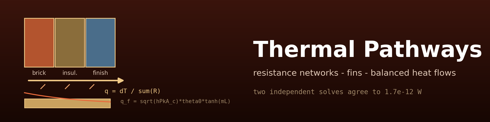
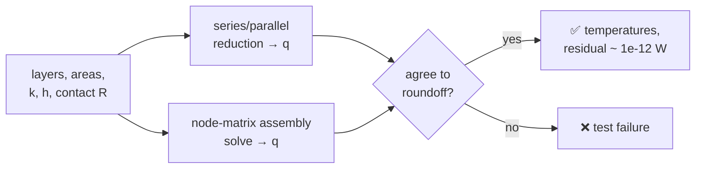
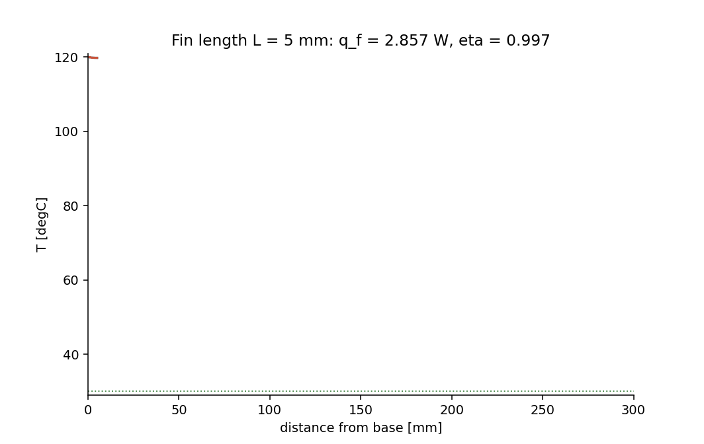

<div align="center">



# 🌉 Thermal Pathways

### Resistance networks, fins & balanced heat flows

**An original Python toolkit — composite-wall networks cross-checked between
node-matrix and direct reduction with roundoff energy balances (1.7e-12 W), exact
straight-fin analytics with three tip treatments, and a quantitatively balanced fin
Sankey closing to 0.0 W.**

[](https://github.com/khalil-work/thermal-pathways/actions/workflows/ci.yml)
[](LICENSE)
[](requirements.txt)
[](tests)
[](docs/verification.md)
[](https://github.com/khalil-work/thermal-pathways/stargazers)
[](https://github.com/khalil-work/thermal-pathways/commits)

[Homepage](https://khalil-work.github.io) · [Quick start](#-quick-start) · [Method](#-model-method-and-guarantees) · [Animation](#%EF%B8%8F-results-gallery) · [Metrics](#-results-and-metrics) · [References](#-references)

</div>

---

## 🎯 Purpose and scope

Verification-first 1-D thermal tools:

| Tool | Guarantee |
| --- | --- |
| 🧱 **Composite-wall networks** (series + one-level parallel) | solved two independent ways that must agree to roundoff |
| 🌡️ **Straight-rectangular-fin analytics** | insulated, corrected-length, and exact convective tip treatments |
| 📊 **Balanced fin Sankey** | node totals proven to close before anything is drawn (raises above 1e-9·q_f) |

> **Scope:** steady 1-D conduction/convection, constant properties, no radiation.
> Not a 2-D/3-D or transient solver.

## 🧮 Model, method, and guarantees

- Wall: R = L/(kA), 1/(hA), contact R; series/parallel reduction AND node-matrix
  assembly — the tests require both to agree.
- Fin: θ(x) = θ0 cosh(m(L−x))/cosh(mL); q_f = √(hPkAc)·θ0·tanh(mL); corrected
  length Lc = L + Ac/P; exact convective-tip solution.
- Sankey: analytic section rates split q_f exactly; the builder RAISES if the
  balance exceeds 1e-9·q_f. One consistent quantity (watts), computed model output,
  residual printed on the figure.
- NaN/inf/non-numeric and non-positive physical inputs rejected everywhere.

Details: [docs/model.md](docs/model.md); API: [docs/api.md](docs/api.md).

### Wall solve, both ways



## ⚡ Quick start

```bash
python -m pip install -r requirements-dev.txt
python -m pytest tests -q                       # 27 verification tests
python examples/run_verification.py             # figures + GIF + raw data
```

Verified: Python 3.13.5, NumPy 2.1.3, Windows 11; CI on Ubuntu. Tests < 1 s;
results script ≈ 10 s.

<details>
<summary><b>🧱 Architecture & API example</b></summary>

```
thermal_pathways/
├── networks.py     # segments, series/parallel, node-matrix solve_wall
├── fins.py         # StraightRectangularFin (three tip treatments)
├── sankey.py       # balanced fin_sankey + draw_sankey
└── validation.py   # require_positive / require_finite
tests/  examples/run_verification.py  docs/ model.md api.md verification.md results/
```

```python
from thermal_pathways import ConductionSegment, solve_wall

wall = [ConductionSegment("brick", 0.10, 0.7, 2.0),
        ConductionSegment("insulation", 0.08, 0.04, 2.0)]
s = solve_wall(wall, 100.0, 20.0)
print(s.heat_rate, s.energy_balance_residual())
```

</details>

## ✅ Verification

27 tests in four groups (see [docs/verification.md](docs/verification.md)):
hand-computed walls, matrix-vs-reduction cross-checks, roundoff energy balances at
every node, parallel superposition, fin analytics (symmetry, limits, ordering), and
full input validation.

## ⚠️ Limitations

- 1-D steady state; constant properties; no radiation; series + one-level parallel
  networks only.
- Straight rectangular fins only (no annular/pin fins — no Bessel functions
  required or claimed).
- The Sankey visualizes computed model output, not measured energy.

---

## 🎞️ Results gallery

<div align="center">

**▶ Watch the fin grow:**



<sub>41 frames — each is the full analytic solution at that fin length
(aluminum 50×3 mm, k = 200 W/(m·K), h = 60 W/(m²·K), T_b = 120 °C,
T_∞ = 30 °C), with the computed heat rate and efficiency. Produced by
<code>examples/run_verification.py</code>.</sub>

</div>

### 📈 Results and metrics

| Case | Metric | Value |
| --- | --- | --- |
| Recorded wall (5 elements, 100→20 °C) | energy-balance residual | **1.7e-12 W** |
| Two-layer hand case | R / q / interface T | 0.05 K/W / 1600 W / 68 °C exact (1e-12) |
| Parallel hand case | branch shares | 200 + 400 = 600 W exact |
| Fin midpoint symmetry | error | **0.0 K** |
| Fin efficiency / effectiveness (recorded case) | η / ε | 0.4427 / > 1 |
| Fin Sankey | inflow − Σ outflows | **0.0 W** |

### 🖼️ Static figures & raw data

Raw data: [docs/results/](docs/results) — `wall_nodes.csv`, `wall_links.csv`,
`fin_sankey.csv`, `run_summary.json`; figures
[wall_profile.png](docs/results/wall_profile.png),
[fin_solution.png](docs/results/fin_solution.png),
[fin_sankey.png](docs/results/fin_sankey.png), animation
`fin_length_progression.gif`.

## 📚 References

- T. L. Bergman, A. S. Lavine, F. P. Incropera, D. P. DeWitt, *Fundamentals of
  Heat and Mass Transfer* (wall networks, fin analysis, corrected-length method).
- P. J. Schneider, *Conduction Heat Transfer* (fin analysis context).

Dependencies: NumPy (BSD-3), Matplotlib (PSF-based), Pillow (HPND),
pytest (MIT). This repository's own code is original and MIT-licensed; see
[LICENSE](LICENSE).
